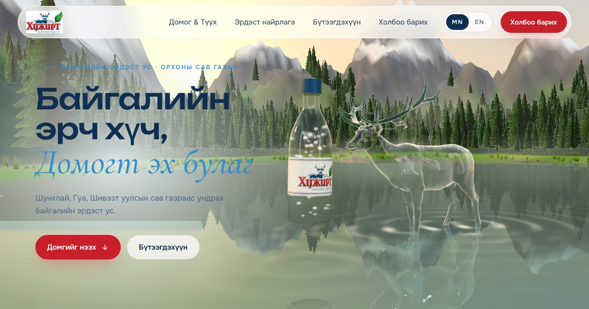

# Хужирт — Байгалийн эрдэст ус

Хужирт брэндийн вэб сайт: нар жаргах үеийн хөндийд, нуурын усан дундаас бүрэлдэх шилэн тунгалаг буга, Хужирт лонх, нарсан ой, цастай Шунхлай · Гуа · Шивээт уулс бүхий 3D түүх. Гүйлгэх тусам домог дөрвөн агшинд өрнөнө: шархадсан буга → гурван уулын дундах эх → эдгэрэл → өнөөдөр. Монгол / англи хэлтэй.



## Бүтэц

Frontend нь repo-гийн үндсэн хавтсанд (Next.js 15 App Router, React 19, Tailwind CSS v4,
Three.js + React Three Fiber + drei, GSAP ScrollTrigger, Lenis), backend нь `backend/` хавтсанд
(Python Cloudflare Worker + D1, [backend/README.md](backend/README.md)).

```
khujirt/
├── app/
│   ├── [lang]/layout.tsx · page.tsx   /mn, /en хуудас, SEO metadata, JSON-LD
│   ├── api/contact/route.ts           маягт → Python API proxy
│   ├── sitemap.ts · robots.ts · manifest.ts · icon.svg · apple-icon.png
│   └── globals.css                    брэндийн өнгө (@theme), бүрэлдэхүүн
├── components/
│   ├── three/      3D тайз: Deer (шилэн буга), StagParticles (GPU цэгэн буга), Bottle,
│   │               Lake (тусгал, долгион), Droplets (дусал), Terrain + landscape.ts (уул, нуга),
│   │               Forest (нарс), Shore (чулуу, өвс), Sky (алтлаг тэнгэр), Mist, CameraRig,
│   │               story.ts (гүйлгэлтийн төлөв)
│   ├── sections/   Hero, Legend, Facts, Products, Contact
│   ├── layout/     Header, Footer, SmoothScroll (Lenis)
│   └── StoryDriver.tsx                ScrollTrigger → 3D түүхийн timeline
├── lib/            i18n.ts (MN/EN текст), content.ts (бүтээгдэхүүн), api.ts, site.ts
├── public/         models/deer.glb (221 KB, meshopt), models/stag-points.bin,
│                   brand/khujirt-logo.webp, og/ (хуваалцах зураг)
└── backend/        Python API (Cloudflare Worker + D1)
```

## Өнгө

Сайтын UI бараан биш — Хужиртын логоны өнгө: улаан `#c8202a` (бичиг), хар хөх `#0e2f52` (буга), тэнгэрийн цэнхэр `#2f8fd1`, ногоон `#3ea535` (навч), цасан цагаан. 3D тайз нь нар жаргах үеийн алтлаг гэрэлтэй; буга нь ус, шил шиг тунгалаг (`MeshPhysicalMaterial` transmission, IOR 1.45, dispersion, ирмэгийн гэрэл).

## Локал дээр ажиллуулах

```bash
npm install
npm run dev            # http://localhost:3000 → /mn
npm run build && npm start
```

Backend-гүйгээр ч бүрэн ажиллана: бүтээгдэхүүн, тоонууд `lib/content.ts`-ээс уншигдана. Холбоо барих маягт API тохируулсны дараа ажиллана.

## Vercel дээр байршуулах

Тохиргоо шаардлагагүй: [vercel.com/new](https://vercel.com/new) → **Khujirt** repo → **Import** → **Deploy**.
Төслийн нэр `khujirt` тул хаяг нь **khujirt.vercel.app** болно. `main` руу push хийх бүрт автоматаар шинэчлэгдэнэ.

Vercel дээр env тохируулах шаардлагагүй: API-ийн хаяг `lib/api-endpoint.json`-д бичигдэнэ.
Хүсвэл (`.env.example`): `KHUJIRT_API_URL` — өөр API хаяг, `NEXT_PUBLIC_SITE_URL` — өөр домэйн (ж: `https://khujirt.mn`).

## Cloudflare D1 + Python API

D1 бааз `khujirt-db` үүссэн, migration-ууд хийгдсэн (ID нь `backend/wrangler.toml`-д).
Worker-ийг GitHub Actions байршуулна (`.github/workflows/deploy-api.yml`): `backend/` өөрчлөгдөх бүрт
тест → D1 migration → `wrangler deploy` → `IP_HASH_SALT` (анх удаа) → шалгалт → хаягийг `lib/api-endpoint.json`-д бичнэ.

Нэг удаа: repo → Settings → Secrets and variables → Actions → `CLOUDFLARE_API_TOKEN`
(Cloudflare → My Profile → API Tokens → **Edit Cloudflare Workers** загвар + **Account · D1 · Edit**).

Дэлгэрэнгүй: [backend/README.md](backend/README.md).

## Агуулга засах

- Текст (MN/EN): `lib/i18n.ts`
- Бүтээгдэхүүн: D1 `products` хүснэгт (сайт 10 минут тутамд шинэчилнэ) — нөөц хувилбар `lib/content.ts`
- Тоон баримт: D1 `facts` хүснэгт (`since`, `mineral_count`, `additives`)
- 3D түүхийн камер, манан, долгион: `components/three/story.ts` → `STATES`
- Хөл хэсгийн уриа: `lib/i18n.ts` → `footer.manifesto`; брэндийн бичлэг: `public/media/khujirt-amlalt.mp4` (дуугүй, зөвхөн дэлгэцэнд харагдах үед тоглоно, постер `khujirt-amlalt.webp`)

Бүтээгдэхүүний зураг, мэдээллийг [gem.mn](https://www.gem.mn/mn/brands/khujirt-gem)-ийн Хужирт хуудаснаас авсан.

## Гүйцэтгэл ба хүртээмж

- 3D тайз хуудасны агуулгын дараа тусдаа ачаалагдана (`next/dynamic`, SSR-гүй); текст, SEO агуулга шууд HTML-ээр ирнэ.
- Бугын загвар ~12 MB → 221 KB (бүтэц хассан, meshopt + quantization).
- `PerformanceMonitor` удаан төхөөрөмж дээр нягтралыг бууруулна; утсан дээр цэг, тусгалын нягтрал бага.
- `prefers-reduced-motion` үед гүйлгэлтийн хөдөлгөөн, Lenis унтарна.
- Фонт өөр дээрээ (Unbounded, Onest, Cormorant — кирилл үсэгтэй).

## Лиценз ба зохиогч

Бугын 3D хэлбэр: [“Realistic Deer 3D Model 2.0”](https://sketchfab.com/3d-models/realistic-deer-3d-model-20-demo-free-download-30bd8d8458c54b0cb2d66cc12471f1d0) — [WildMesh 3D](https://sketchfab.com/WildMesh_3D), [CC BY 4.0](https://creativecommons.org/licenses/by/4.0/). Цэгэн болон усан хэлбэрт хувиргасан. Лицензийн дагуу сайтын хөл хэсэгт байгаа зохиогчийн тэмдэглэлийг хадгална уу.

Хужирт нэр, лого нь эзэмшигчийнх.
